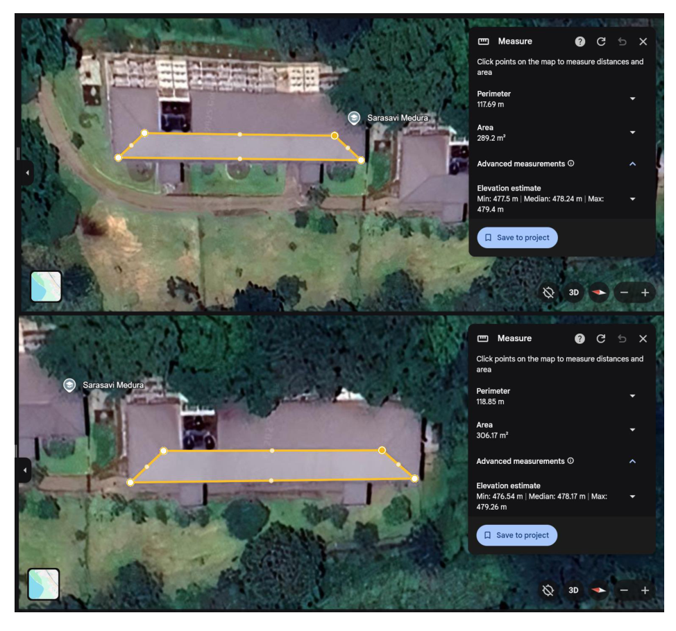
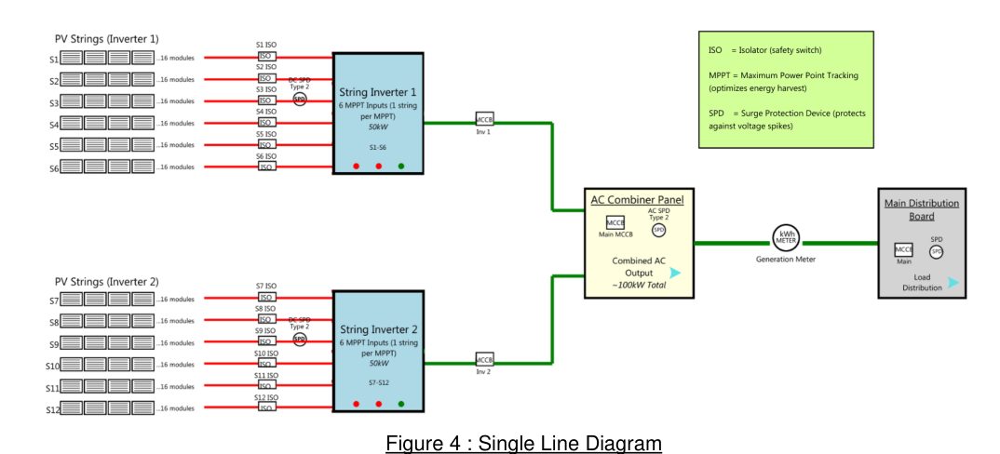
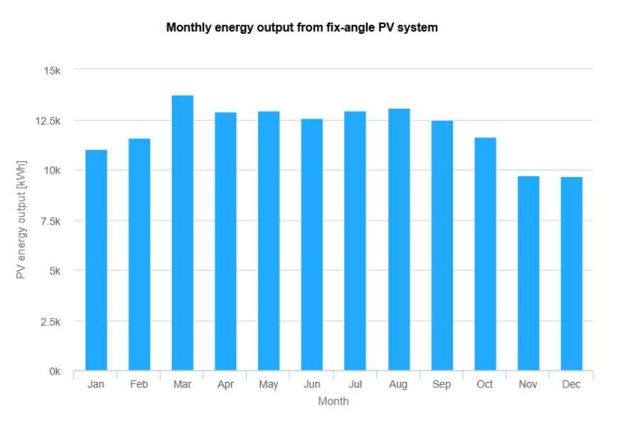

# EE256 Rooftop Solar Plant Design and Analysis

**A university solar design study that inspired my home solar installation.**

This repository brings together the original EE256 assignment brief and our Group 18 report for a proposed rooftop solar PV plant at Sarasavi Madura Hostel, University of Peradeniya. The study covers roof assessment, system sizing, electrical layout, PVGIS analysis, energy demand, and financial evaluation.

**[Read the project report](docs/EE256_Group_18_Rooftop_Solar_Report.pdf)** · **[Download the assignment brief](docs/EE256_Assignment_Brief_2025.docx)**

## Project at a glance

| Item | Proposed hostel system |
|---|---|
| Course | EE256 Power and Energy |
| University | University of Peradeniya |
| Group | EE.21.18 / Group 18 |
| Report date | 30 August 2025 |
| Site | Sarasavi Madura Hostel, Peradeniya |
| Combined assessed roof area | 595.4 m² |
| Area after the report's 15% allowance | Approximately 506.1 m² |
| Proposed PV array | 192 × 545 W modules |
| Proposed DC capacity | 104.64 kWp |
| Proposed AC inverter capacity | 2 × 50 kW = 100 kW |
| Proposed string arrangement | 12 strings, 16 modules per string |
| Solar-resource tool | PVGIS |

These are proposal values transcribed from the submitted report. The hostel project is an academic design study; the report does not document its construction. Technical assumptions and calculation review points are listed in [Calculation notes](docs/CALCULATION_NOTES.md).

## What the study covers

1. **Site and roof assessment:** usable roof areas, shading, obstructions, and module placement.
2. **PV system design:** panel selection, array sizing, strings, and electrical layout.
3. **Demand estimation:** weekday and weekend hostel electricity use.
4. **Solar-resource assessment:** PVGIS irradiation data and seasonal patterns.
5. **Performance analysis:** monthly energy estimates and temperature effects.
6. **Financial evaluation:** estimated savings, export income, cash flow, and NPV under the assignment assumptions.

## Electrical layout

The figure reproduces the submitted academic layout. Refer to the report for the design context and to the calculation notes for items requiring review before practical use.

## PVGIS analysis

The report includes PVGIS figures showing monthly generation, irradiation, and seasonal variation. The [monthly output CSV](data/monthly_pv_output_report_table_5.csv) is a transcription of **Table 5 on page 18**, provided for easy inspection and plotting. The figure above is from page 12; the report contains multiple simulation outputs, so their configurations should be reconciled before treating them as one dataset.

Original PVGIS exports and editable calculation workbooks are not included. The calculations, assumptions, diagrams, and simulation screenshots are contained in the PDF report.

## My contribution

**P. G. I. N. B. Rathnayaka · E/21/327**

The report records my role as **Project Engineer and Design Engineer**, with a 14% contribution and responsibility for **Task 1(c), electrical layout, and Task 1(d), daily demand estimation**. This was a team project; the complete contribution statement appears on page 27 of the report.

## From the hostel study to Solar Pulse

This assignment encouraged me to apply the same design approach to a separate installation at home. Before installation, I used PVGIS to explore the solar resource and carried out calculations to guide the setup.

| Component | My home installation |
|---|---|
| Inverter | PowMr 1 kW, 12 V hybrid inverter |
| AC output | 230 V, 50 Hz |
| Solar array | One Jinko 580 W monocrystalline panel, 580 Wp total |
| Charge controller | Inverter's internal MPPT controller |
| Battery | 12 V, 100 Ah LiFePO₄, approximately 1.2 kWh nominal storage |
| Battery management | JK BMS B1A8S10P |
| Operating objective | Solar self-consumption with battery storage and automatic CEB fallback |

The **1 kW** figure is the home inverter's rated output capacity; **580 Wp** is the installed panel capacity. This home system is separate from the proposed **104.64 kWp** hostel array.

Solar Pulse builds on this practical work through smart monitoring and home energy management. This repository currently contains the hostel assignment documents and report figures; home-installation photographs, home PVGIS exports, and Solar Pulse firmware are not included in this release.

## Acknowledgements

My sincere thanks to **Professor Janaka Ekanayake** for the engaging EE256 assignment that inspired this work, and to my Group 18 teammates for their contributions to the hostel solar design study.

## Repository contents

| File or folder | Contents |
|---|---|
| [docs/EE256_Assignment_Brief_2025.docx](docs/EE256_Assignment_Brief_2025.docx) | Original lecturer-provided assignment brief |
| [docs/EE256_Group_18_Rooftop_Solar_Report.pdf](docs/EE256_Group_18_Rooftop_Solar_Report.pdf) | Original submitted report, including calculations and group credits |
| [docs/CALCULATION_NOTES.md](docs/CALCULATION_NOTES.md) | Source locations, assumptions, and review points |
| [assets/](assets/) | Selected figures reproduced from the report |
| [data/](data/) | Monthly energy data transcribed from report Table 5 |
| [UPLOAD_GUIDE.md](UPLOAD_GUIDE.md) | GitHub upload steps and optional images to add |

## Sources and reuse

- The assignment brief and team report are preserved without content edits; filenames have been simplified for repository links.
- Images are reproduced from the report, with source pages identified in their captions. Existing map and chart attribution remains part of those source figures.
- PVGIS is the European Commission Joint Research Centre's solar-resource tool. Its address is given in the assignment brief: https://re.jrc.ec.europa.eu/pvg_tools/en/#PVP
- Cost, tariff, and financial assumptions reflect the submitted assignment context. They are not current quotations or measured home-system savings.
- No repository-wide open-source license is assigned. The lecturer's assignment, team report, and third-party figures retain their respective authorship and rights. Please credit the original contributors when referring to the work.
